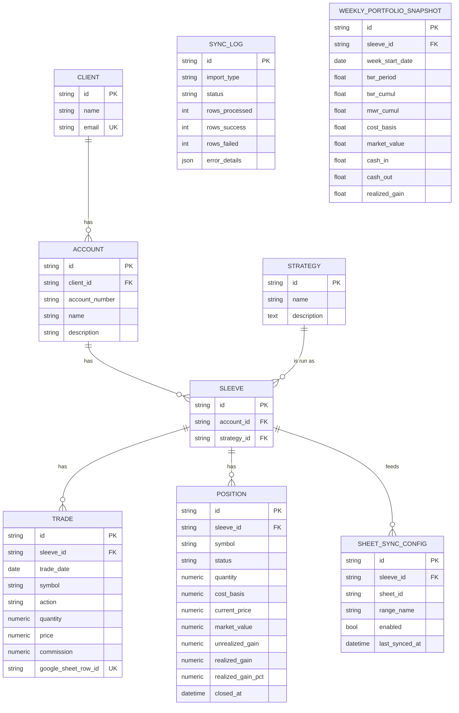

# PMS Data Model

Current schema after the **Sleeve refactor** (migration `fe521b07fb54`). All primary keys are
`String(36)` UUIDs. Timestamps (`created_at`, `updated_at`) are timezone-aware via `BaseModel`.

## Hierarchy at a glance

```
Client ──< Account ──< Sleeve >── Strategy        (Sleeve = account × strategy instance)
                          │
                          ├──< Trade
                          ├──< Position
                          ├──< CashActivity
                          └──< SheetSyncConfig

Client ──< BrokerageConnection ──< BrokerageAccount ──> Account, Sleeve   (linked logins)
                                        └──< BrokerageActivity            (source rows, verbatim)

SyncLog                                            (standalone import/sync audit trail)

perf.daily_valuation  (per sleeve and per account, per day)     perf.daily_price
perf.daily_holding    (per account, per security, per day)      perf.corporate_action
```

- A **Strategy** is a firm-wide *definition* ("Growth", "Income") — reusable across accounts
  and clients.
- A **Sleeve** is one strategy *as run in one account*. It's the join between `Account` and
  `Strategy`, and it owns trades, positions and sync configs.
- One Strategy → many Sleeves (same strategy across many accounts/clients).
- One Account → many Sleeves (an account runs several strategies).

## ER diagram



## Tables

### `clients`
| Column | Type | Notes |
|---|---|---|
| id | String(36) PK | uuid |
| name | String(255) | not null |
| email | String(255) | not null, **unique** |

Relationships: `accounts` (1→N, cascade delete).

### `accounts`
| Column | Type | Notes |
|---|---|---|
| id | String(36) PK | uuid |
| client_id | String(36) FK→clients.id | not null, **ON DELETE CASCADE** |
| account_number | String(50) | nullable (e.g. "10000001") |
| name | String(255) | not null |
| description | String(500) | nullable |

Relationships: `client` (N→1), `sleeves` (1→N, cascade delete).

### `strategies`  *(firm-wide definition)*
| Column | Type | Notes |
|---|---|---|
| id | String(36) PK | uuid |
| name | String(255) | not null; **unique case-insensitively** |
| description | Text | nullable |

Constraints: unique functional index `uq_strategy_name_lower` on `lower(name)` — "Growth"
and "growth" are the same definition. Relationships: `sleeves` (1→N). No
`account_id`/`client_id` — a strategy is global.

### `sleeves`  *(account × strategy instance)*
| Column | Type | Notes |
|---|---|---|
| id | String(36) PK | uuid |
| account_id | String(36) FK→accounts.id | not null, **ON DELETE CASCADE** |
| strategy_id | String(36) FK→strategies.id | not null, **ON DELETE RESTRICT** |
| accounting_method | String(20) | not null, default `ROUND_TRIP`; `FIFO` for brokerage-linked sleeves |

`accounting_method` decides how SELLs are matched to BUYs when deriving positions:
`ROUND_TRIP` pairs equal quantities (strategy sheets record discrete round trips, and a SELL
with no equal-quantity BUY is ignored); `FIFO` consumes the oldest lots and splits them on a
partial sell, which real brokerage activity needs. FIFO also handles **short sales**: a SELL
beyond the shares held opens a short lot, a later BUY covers the oldest short lots first, and
an open short is a position with negative quantity and negative cost basis. A sleeve set mixing both is matched sleeve
by sleeve and rolled up per symbol.

Constraints: `UNIQUE(account_id, strategy_id)` — one sleeve per strategy per account.
`RESTRICT` on `strategy_id` prevents deleting a strategy definition that still has live
sleeves. Relationships: `account`, `strategy` (N→1); `trades`, `positions` (1→N, cascade).

### `trades`
| Column | Type | Notes |
|---|---|---|
| id | String(36) PK | uuid |
| sleeve_id | String(36) FK→sleeves.id | not null, **ON DELETE CASCADE** |
| trade_date | Date | not null |
| symbol | String(50) | not null; wide enough for `NYSEARCA:VOO`-style prefixes |
| action | String(10) | not null; check `IN ('BUY','SELL')` |
| quantity | Numeric(18,8) | not null; check `> 0`; 8 dp holds fractional shares |
| price | Numeric(15,6) | not null; check `> 0` |
| commission | Numeric(15,6) | default 0 |
| notes | Text | nullable (broker descriptions are unbounded) |
| google_sheet_row_id | String(255) | **unique**; null for CSV-sourced trades |
| external_id | String(255) | indexed, nullable; **unique per sleeve** — see below |
| security_type | String(20) | nullable — `ETF` / `STOCK` / `ADR` / `MUTUAL_FUND` / … as the source reported it; NULL for CSV, Sheets and manual trades |

`external_id` is the source-derived idempotency key from
`connectors/models.NormalizedTrade`, persisted so `UNIQUE(sleeve_id, external_id)`
enforces idempotency in the database rather than only in the ingesting process.
It is nullable: trades created directly through the API, and any predating the
column, have none. Dedup therefore accepts **either** identity — the
`external_id`, or the legacy `(date, symbol, qty, price)` tuple.

### `positions`
| Column | Type | Notes |
|---|---|---|
| id | String(36) PK | uuid |
| sleeve_id | String(36) FK→sleeves.id | not null, **ON DELETE CASCADE** |
| symbol | String(50) | not null; tracks `trades.symbol` |
| status | String(10) | not null, default `OPEN`; `OPEN` or `CLOSED` |
| quantity | Numeric(18,8) | not null (0 for closed rows); tracks `trades.quantity` |
| cost_basis | Numeric(18,2) | not null (0 for closed rows) |
| current_price | Numeric(15,6) | nullable (persisted market price) |
| market_value | Numeric(18,2) | nullable |
| unrealized_gain | Numeric(18,2) | nullable (open positions only) |
| realized_gain | Numeric(18,2) | nullable (set on closed rows) |
| realized_gain_pct | Numeric(10,4) | nullable (set on closed rows) |
| closed_at | DateTime(tz) | nullable (date of the final sell-out) |
| last_updated | DateTime(tz) | set on persist |

No unique constraint on `(sleeve_id, symbol)`: a symbol can have one `OPEN` row plus
one or more `CLOSED` rows. Realized gain is computed by **quantity-matched round-trips** —
each SELL is paired with the earliest unmatched BUY of the **same symbol and same quantity**
within the sleeve (a sleeve is account × strategy, so matching is also scoped to one
strategy). Each matched pair is one `CLOSED` row with
`realized_gain = (exit - entry) * qty - commissions`. Any BUY left unmatched rolls up into
the `OPEN` position. A SELL with no matching BUY is ignored (out-of-scope data, not an error).
(Migration `8f45b7a41fcf`.)

### `sheet_sync_configs`
| Column | Type | Notes |
|---|---|---|
| id | String(36) PK | uuid |
| sleeve_id | String(36) FK→sleeves.id | not null, **ON DELETE CASCADE** |
| sheet_id | String(255) | not null |
| range_name | String(100) | default "Sheet1" |
| enabled | Boolean | not null, default true |
| last_synced_at | DateTime(tz) | nullable |

Client is derived via `sleeve → account.client_id` (the old `client_id` column was dropped).

### `sync_logs`
| Column | Type | Notes |
|---|---|---|
| id | String(36) PK | uuid |
| import_type | String(20) | "HISTORICAL", "DAILY" or "BROKERAGE" |
| status | String(20) | PENDING / IN_PROGRESS / SUCCESS / FAILED |
| rows_processed / rows_success / rows_failed | Integer | default 0 |
| error_details | JSON | nullable |
| started_at / completed_at | DateTime(tz) | nullable |

Standalone audit trail — no FK to the entity hierarchy.

## The `perf` schema — performance over time

Everything that describes how accounts and sleeves performed over time lives in its own
Postgres schema, `perf`, apart from the operational tables in `public`. New performance tables
go here. Foreign keys point back to `public.accounts` / `public.sleeves` with `ON DELETE
CASCADE`. (Tests run on SQLite, which has no schemas; `tests/conftest.py` maps `perf` onto the
default schema with `schema_translate_map`.)

**One stored grain: the day.** Weeks, months, quarters, years, year-to-date, since-inception,
and the client and strategy roll-ups are *not stored*; `PerformanceStatsService` reads them from
the daily rows by one rule each, so two views cannot disagree and there is one thing to restate.

**Two kinds of day.** An *observed* day was captured from the brokerage's own holdings, cash
and total on the day (`DailyCaptureService`); its values are fact and are never rewritten. A
*reconstructed* day was rebuilt from trades and price history (`PerformanceBuildService`): the
past before capture began, and any day the capture did not run. Reconstructed rows are replaced
on every rebuild; on observed rows only the flows and the day's return are refreshed, as late
transactions arrive.

### `perf.daily_valuation`
One row per sleeve per market day and one per account per market day, including days when
nothing happened. Every return and report figure is read from this table.

| Column | Type | Notes |
|---|---|---|
| id | String(36) PK | uuid |
| sleeve_id | String(36) FK→sleeves.id | **CASCADE** — set for a sleeve row |
| account_id | String(36) FK→accounts.id | **CASCADE** — set for an account row |
| as_of_date | Date | |
| securities_value | Numeric(18,2) | holdings at the day's close; a short is negative |
| cost_value | Numeric(18,2) | what the positions open at the day's close had cost (FIFO lots; a short is the proceeds received, negative) |
| cash_value | Numeric(18,2) | account rows only; NULL where cash is not tracked |
| total_value | Numeric(18,2) | securities + cash |
| flow_in / flow_out | Numeric(18,2) | money put in / taken out that day |
| advisory_fees | Numeric(18,2) | 0 until advisory fees are in use |
| return_factor | Numeric(18,10) | 1 + the day's time-weighted return; NULL with no capital at work |
| unpriced_value | Numeric(18,2) | part of securities held at last traded price (options, delisted names) |
| basis | String(15) | `observed` \| `reconstructed` |
| is_provisional | Boolean | the brokerage's transactions for the day may still be arriving |
| computed_at | DateTime(tz) | |

Constraints: exactly one of `sleeve_id` / `account_id` (CHECK); `UNIQUE(sleeve_id, as_of_date)`;
`UNIQUE(account_id, as_of_date)`.

"Money in / out": for an **account**, deposits, withdrawals and transfers across its boundary
(trades and dividends only move value between cash and securities). For a **sleeve**, which has
no cash, purchases in and sale proceeds and income out. An account with no reported cash is
treated like a sleeve. On a provisional captured day a sleeve's flows are read off the change
in what it holds, until the trades themselves arrive.

Conventions: daily return is Modified Dietz with flows at mid-day
(`performance_build_service.dietz_factor`); period returns chain the daily factors; periods
longer than a year are annualised on a 365.25-day year; a roll-up adds values and flows across
its members and applies the same rules to the sums.

**Two bases for reading the same rows** (`PerformanceStatsService.daily(basis=…)`, and the
`basis` query parameter on the periods, monthly and returns-series endpoints):
- `market` (default): holdings at each day's prices; a return includes gains not yet taken.
- `realized`: holdings at `cost_value`; a gain counts only on the day its position is closed,
  and unrealised gains are left out of values and returns. The day's return then counts money in
  from the start of the day and money out at its end (`realized_factor`), since at cost a gain
  appears at the moment the proceeds leave. The two bases agree once nothing is left open.

**Where rebuilt days meet recorded days.** A rebuilt day values holdings from trade and price
history; a recorded day uses the brokerage's own figures. Options have no price history, so a
rebuilt day carries them at what was paid or received, and the first recorded day shows their
market value. That step is counted as that day's return: it is gain or loss that built up
earlier and could not be seen until the brokerage's value was captured. It is not set aside as
an adjustment, so `opening + net_flow + gain = closing` holds for every period and returns agree
with the reported value. The cost is timing: the step lands on one day instead of being spread
over the days it accrued.

The Performance page reads everything at market. The realised basis is available from the API
but no screen uses it at present.

### `perf.daily_holding`
What the brokerage reported an account as holding on one day: `account_id` (CASCADE),
`sleeve_id` (SET NULL), `as_of_date`, `symbol`, `security_type`, `quantity`, `price`,
`market_value`, `captured_at`; `UNIQUE(account_id, as_of_date, symbol)`. A record of fact,
captured on the day and not recoverable afterwards; not a per-position performance history. A
holding's sleeve is the one already holding its symbol, else the route for its security type,
else the default sleeve.

### `perf.daily_price`
`symbol`, `price_date`, `close`, `source`, `fetched_at`; `UNIQUE(symbol, price_date, source)`.
`webull` closes are **adjusted for later splits and dividends** and the source restates the
whole series when a new one occurs, so a symbol's series is always replaced whole
(`PriceHistoryService.backfill`). `brokerage` closes are the price the brokerage put on a
holding the day it was captured, unadjusted. Also holds benchmark tickers (SPY, QQQ, AGG, DIA);
SPY's dates serve as the market calendar. Because the history is adjusted, a past holding is
valued by tying the series to the price it actually traded at and using only its movement
since (see `PerformanceBuildService`); an option assignment, which trades at the strike and not
the market, is not used to calibrate.

### `perf.corporate_action`
`symbol`, `effective_date`, `action_type` (`SPLIT` so far), `ratio`, `source`;
`UNIQUE(symbol, effective_date, action_type)`. Recorded from the SPLIT rows in
`brokerage_activities`. Trades are never altered: `corporate_actions.adjusted_trades` restates
earlier trades in today's shares **on read** (4 shares at 1,000 before a 10-for-1 split is read
as 40 at 100), which every position, value and return calculation goes through.

### `cash_activities`
| Column | Type | Notes |
|---|---|---|
| id | String(36) PK | uuid |
| sleeve_id | String(36) FK→sleeves.id | not null, **ON DELETE CASCADE** |
| activity_date | Date | not null |
| type | String(20) | `DIVIDEND` / `INTEREST` / `FEE` / `WITHHOLDING` / `CONTRIBUTION` / `WITHDRAWAL` / `TRANSFER` / `OTHER` |
| symbol | String(50) | nullable — the security the money relates to |
| amount | Numeric(18,2) | signed; positive is cash received |
| notes | Text | nullable |
| external_id | String(255) | not null, indexed — source-derived idempotency key |

Constraints: `UNIQUE(sleeve_id, external_id)`.

Non-trade money movements. Performance is securities-only (no cash balance), so only some of
these are returns: `FEE` always, and `DIVIDEND` / `INTEREST` / `WITHHOLDING` when paid on a
symbol the sleeve set has traded. They enter MWR as cash flows and TWR/monthly returns via
`cash_out`. Contributions, withdrawals, transfers and income on untraded symbols (a settlement
fund's interest) are stored for audit and never counted. See `CashActivityService.income_flows`.

### `brokerage_connections`
| Column | Type | Notes |
|---|---|---|
| id | String(36) PK | uuid |
| client_id | String(36) FK→clients.id | not null, **ON DELETE CASCADE** |
| source | String(50) | connector registry name, e.g. `snaptrade` |
| external_user_id | String(255) | the user id the login was linked under at the source |
| external_connection_id | String(255) | the source's id for the login |
| institution | String(255) | e.g. "Vanguard" |
| status | String(20) | `active` / `broken` / `deleted` |

Constraints: `UNIQUE(source, external_connection_id)`. One row per brokerage login. Holds
references only — no credentials and no secret (the Personal SnapTrade flow issues none).

### `brokerage_accounts`
| Column | Type | Notes |
|---|---|---|
| id | String(36) PK | uuid |
| connection_id | String(36) FK→brokerage_connections.id | not null, **ON DELETE CASCADE** |
| external_account_ref | String(255) | the source's account id |
| name | String(255) | as reported by the brokerage |
| number_last4 | String(4) | nullable — only the last four characters are kept |
| account_id | String(36) FK→accounts.id | nullable, **ON DELETE SET NULL** — set when mapped |
| default_sleeve_id | String(36) FK→sleeves.id | nullable, **ON DELETE SET NULL** — where synced trades land |
| sleeve_routes | JSON | nullable — security type → sleeve id, e.g. `{"ETF": "…"}`; other types use `default_sleeve_id` |
| sync_start_date | Date | nullable — earliest activity date to load; NULL = full history |
| status | String(20) | `unmapped` / `mapped` / `ignored` |
| initial_sync_completed | Boolean | false while the source is still loading history |
| transactions_synced_through | Date | nullable — the source's own completeness watermark |
| last_synced_at | DateTime(tz) | nullable — gates the 24h-per-account sync limit |
| last_reconciled_at | DateTime(tz) | nullable |
| reconciliation | JSON | nullable — `{matched, drifted[], unmatched_sells, skipped_rows}` |
| cash_balance | Numeric(18,2) | nullable — cash the source last reported; NULL means cash is not tracked |
| cash_balance_at | DateTime(tz) | nullable — when that was read |

Constraints: `UNIQUE(connection_id, external_account_ref)`.

Every account discovered under a login, mapped or not — kept apart from `accounts` because one
login exposes several accounts and some are never brought in. The mapped `Account` may belong
to a **different client** than the connection: one person's login reaches accounts they only
act on as agent, so `connection.client_id` is who holds the login, not who owns each account. Mapping creates the `Account`
and a `FIFO` sleeve (default strategy "Unallocated"). Symbols can later be moved to other
sleeves of the same account (`POST /trades/reassign`); sync dedups across all of the account's
sleeves so moved trades are not re-imported.

**Routing a synced trade to a sleeve**, in order: (1) the sleeve of this account that already
holds the symbol — so a symbol never straddles sleeves and a manual reassignment sticks;
(2) `sleeve_routes[security_type]`; (3) `default_sleeve_id`. Cash activities follow their symbol.

### `brokerage_activities`
| Column | Type | Notes |
|---|---|---|
| id | String(36) PK | uuid |
| brokerage_account_id | String(36) FK→brokerage_accounts.id | not null, **ON DELETE CASCADE** |
| source_activity_id | String(255) | the source's id for the row (may change if reprocessed) |
| activity_date | Date | nullable |
| type | String(50) | the source's type string, unmapped (`BUY`, `SPLIT`, `REI`, …) |
| symbol | String(50) | nullable |
| outcome | String(40) | `trade` / `cash` / `skipped:<reason>` |
| cash_amount | Numeric(18,2) | signed effect on the account's cash; 0 for a move between cash and its sweep fund |
| is_external_flow | Boolean | true for a deposit, withdrawal or transfer across the account boundary |
| payload | JSON | the row exactly as received |

Constraints: `UNIQUE(brokerage_account_id, source_activity_id)`.

Every activity the source returned, **including the rows we skip** (options, splits, rows with
no symbol). `trades` and `cash_activities` are a simplified reading of these: they drop the
settlement date, actual cash amount, currency/FX and the source's own type. Keeping the
originals means that reading can be redone when the rules change, without another pull from a
source limited to one per account per day. Re-fetched rows replace the stored copy.

### Cash and whole-account returns

There is no cash table. `CashLedger` (`services/cash_ledger.py`) derives the balance on any
date as `brokerage_accounts.cash_balance` minus every `brokerage_activities.cash_amount` dated
after it — today's reported balance walked backwards — so no opening balance is needed.

Views of **whole accounts** (account and client level) include it where it is known: value is
securities plus cash, a trade or dividend only moves value between the two, and the only money
in or out is an `is_external_flow` row. Sleeve and strategy views stay **securities-only**
(BUY = money in, SELL = money out), so a level's children do not sum to it: the difference is
cash. Accounts with no reported balance (CSV, Sheets) are securities-only at every level, and a
client mixing both kinds is measured with each account on its own basis.

## Performance roll-ups

Returns are computed by resolving a level to its set of sleeve ids and running one calc over
the **merged** trade stream (not by averaging child returns):

| Level | Sleeve set | Endpoint |
|---|---|---|
| Sleeve | `[sleeve_id]` | `GET /clients/{c}/accounts/{a}/sleeves/{s}/performance` |
| Account | all sleeves where `sleeve.account_id = a` | `GET /clients/{c}/accounts/{a}/performance` |
| Client | all sleeves where `sleeve.account.client_id = c` | `GET /clients/{c}/performance` |
| Strategy | all sleeves where `sleeve.strategy_id = s` | `GET /strategies/{s}/performance` |

Each returns `{ level, id, name, summary, timeseries, children }`.

### Reading performance

| What | Endpoint |
|---|---|
| Periods by `grain=day\|week\|month\|quarter\|year` | `GET …/performance/periods` at sleeve, account, client and strategy level |
| Report figures (period returns, activity, drawdowns, risk) | `GET /clients/{c}/accounts/{a}/performance/statistics` |
| The account report (PDF or HTML) | `GET /clients/{c}/accounts/{a}/report` |
| Summary, value series, weekly returns series, monthly returns | the existing `…/performance`, `…/performance/returns-series`, `…/performance/monthly` |

All are read from `perf.daily_valuation` where it has been built. For a sleeve set with no daily
rows yet (trades entered without a rebuild), the existing endpoints fall back to calculating
from trades. Rebuild the reconstructed rows with `POST /admin/rebuild-performance` (pass
`account_id` to scope to one account).

## Notes / known trade-offs

- **`strategies.name` is unique case-insensitively** (`uq_strategy_name_lower` on
  `lower(name)`). The auto-route CSV import and `POST /strategies` both resolve names
  case-insensitively, so "Growth"/"growth" map to one definition (first-seen casing is kept).
  `POST /strategies` returns 409 on a case-insensitive duplicate.
- **`UNIQUE(sleeve_id, external_id)` is the primary trade dedup** (multiple NULLs allowed, so
  API-entered trades are unaffected). `IngestionService` treats a matching `external_id` **or**
  a matching `(date, symbol, qty, price)` tuple as a duplicate, so trades without an
  `external_id` still dedup as before. Quantity and price compare as normalized `Decimal`s,
  not floats, so fractional share counts compare exactly.
- **Brokerage trades dedup on `external_id` alone.** For sources whose id is a complete
  identity (`snaptrade`), the legacy tuple is not consulted: it has no action, so it would drop
  one leg of a same-day buy and sell at one price, which real brokerage data contains.
- **Options are trades counted in contracts.** `symbol` is the OCC symbol, `security_type` is
  `OPTION`, `quantity` is the contract count and `price` is **per contract** (the per-share
  quote × 100). An expiry or assignment is a closing trade at price 0, which is why
  `trades.price` allows zero (`non_negative_price`). Writing an option is a short position.
- **Brokerage coverage gaps are counted, not hidden.** Splits, mergers and rows with an
  unresolvable symbol are skipped by the connector and tallied per sync in `skipped_rows`; the
  resulting share-count differences appear in the account's reconciliation.
- **Stored source rows can be re-read.** `ConnectionService.rederive` runs an account's
  `brokerage_activities` through the current mapping and adds whatever is new, with no call to
  the source.
- **`google_sheet_row_id` is retained but no longer the dedup path** (sheet trades go through
  `external_id` like every other source); it stays available for a future row-id-keyed source.
- **Migration `fe521b07fb54` is Postgres-guarded** and preserves each old strategy id as its
  sleeve id so child FK values didn't need rewriting. SQLite/tests build from the models via
  `create_all`. The follow-up migration `95798c4a2a9a` adds the case-insensitive unique index
  on `lower(name)` (portable across Postgres and SQLite).
